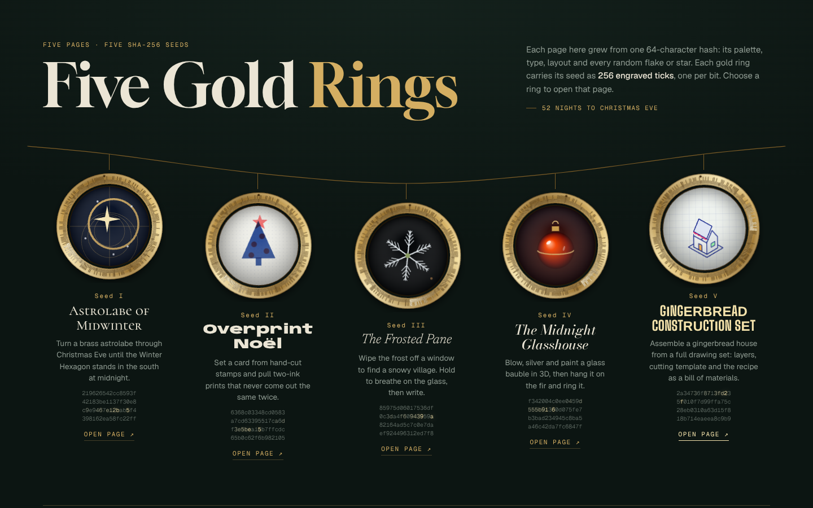
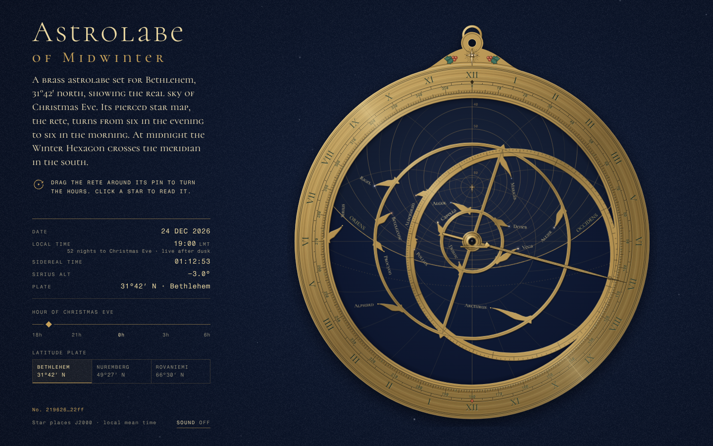
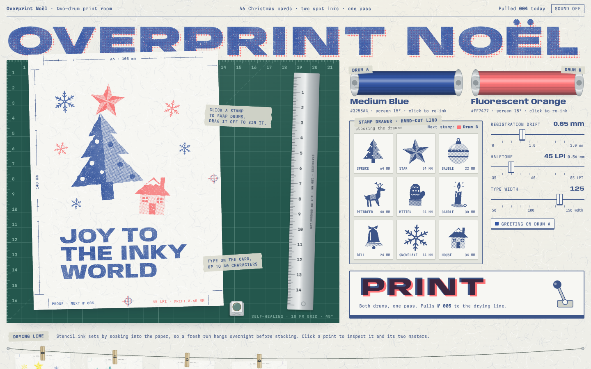
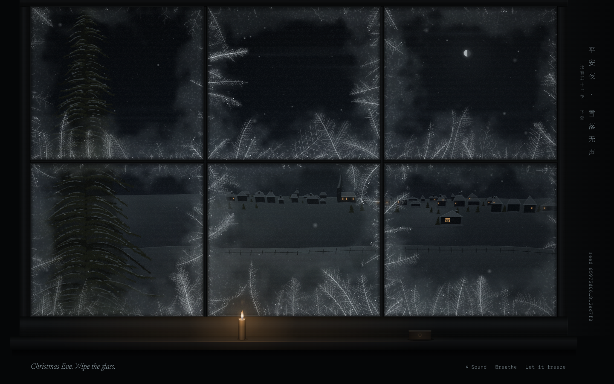
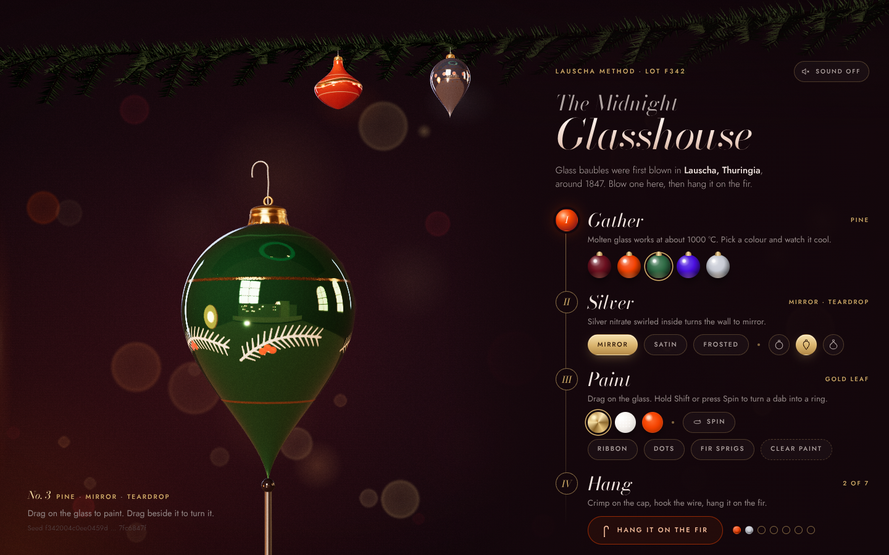
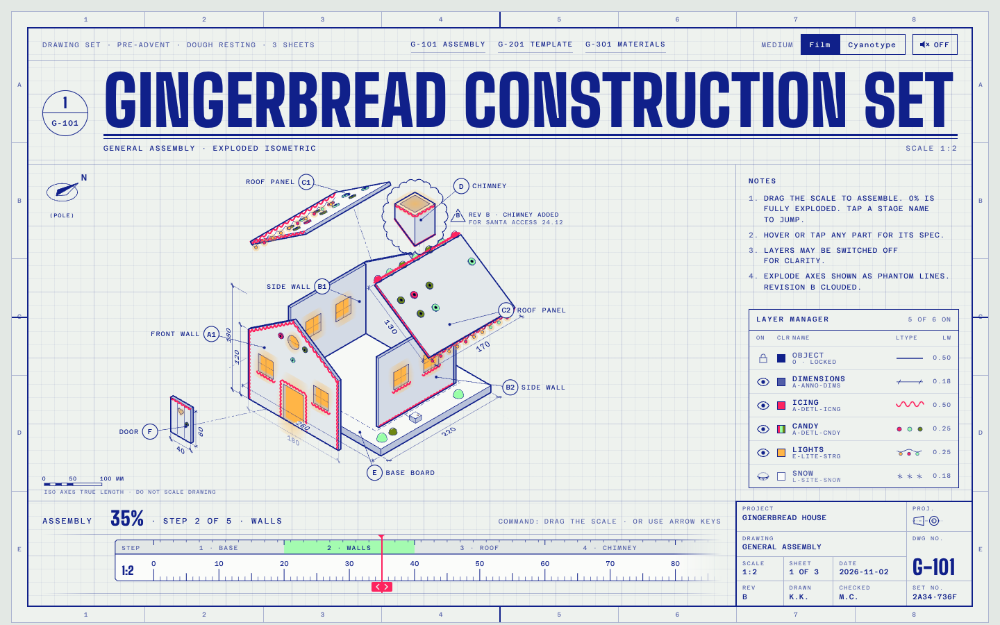

# Five Gold Rings · 五个金戒指

五个可交互的圣诞网页，每一个都从一个 SHA-256 哈希"种子"生长出来：配色、字体、版式、交互方式，以及页面里每一片雪、每一颗星的随机分布，都由各自的种子决定。另有一个大厅页 `index.html` 把它们串在一起。

## 在线版本（claude.ai Artifacts，默认私密，需在 Share 菜单中分享）

| | 页面 | 文件 | 链接 |
|---|---|---|---|
| 大厅 | Five Gold Rings | `index.html` | https://claude.ai/artifact/QzViSsRqDzwuh7vmmbocYT |
| I | Astrolabe of Midwinter | `astrolabe.html` | https://claude.ai/artifact/RMhHepFrqTyxX8x2ktP6qd |
| II | Overprint Noël | `overprint.html` | https://claude.ai/artifact/DPvaA5sCBNhzb1ywzbm69p |
| III | The Frosted Pane | `frosted-pane.html` | https://claude.ai/artifact/4HbocH97u5Rp7Qvfyg8X2q |
| IV | The Midnight Glasshouse | `glasshouse.html` | https://claude.ai/artifact/UebYCbZqvZYCe6S1csGT4J |
| V | Gingerbread Construction Set | `gingerbread-set.html` | https://claude.ai/artifact/28hvjSG6sJjvfPZ1gYXZwT |

## 五个种子与方向

| 种子 | 方向 | 核心交互 |
|---|---|---|
| `219626…22ff` 暗、稀疏、黄铜金 + 夜蓝 | **星盘**：按伯利恒纬度刻制的黄铜星盘 | 拖动星网转动平安夜的时辰，午夜冬季六边形连线；可换纬度盘（伯利恒 / 纽伦堡 / 罗瓦涅米） |
| `6368c0…2105` 油墨色、高密度拼贴 | **孔版印刷工坊** | 拖印章到 A6 贺卡、换滚筒油墨、按 PRINT 套色印刷，晾在绳上 |
| `85975d…f7f8` 近黑、近单色、最空 | **霜窗** | 擦掉窗上的霜看雪夜村庄，长按呵气在雾上写字，上发条的《平安夜》八音盒 |
| `f34200…847f` 深红/松绿、最圆润 | **深夜玻璃工坊**（three.js） | 吹制、镀银、彩绘 3D 玻璃球，挂上枝头会摆动、会响 |
| `2a3473…c9b9` 唯一的浅色底 | **姜饼屋施工图** | 拖比例尺组装爆炸图，CAD 图层开关，切割模板，配料表即食谱；绘图膜 / 蓝晒双主题 |

## 隐藏细节与预览

每页都有一层"靠近才出现"的微交互和一层需要寻找的彩蛋（例如星盘上输入 `STELLA`、孔版印刷里趁滚筒还在转再按 PRINT、霜窗里在雾中画一颗心、玻璃工坊挂满六个后的圣诞腌黄瓜、姜饼屋长按盖章）。完整清单见 `docs/detail-plan.json`。

页面会随访问者的本地日期变化（降临期、平安夜、圣诞节、圣诞十二日）。想提前看，在链接后加 `#advent`、`#christmas-eve` 或 `#christmas-day`。

## 本地打开

直接用浏览器打开任意 `.html` 即可。这些文件是按 claude.ai Artifact 格式写的片段（没有 `<!doctype>`/`<head>`/`<body>`，发布时由平台包上外壳），浏览器也能正常渲染。外部资源只有 Google Fonts 和玻璃工坊用到的 `three@0.149.0`（jsDelivr）。

## 其他文件

- `docs/brief-common.md`：给五个"设计工作室"子代理的统一设计与技术约束
- `docs/detail-plan.json`：灵感调研后提炼的每页细节方案
- `tools/shoot.js`：Playwright 截图/自测脚本（包装成发布外壳，桌面 1440×900 与手机 390×844）
- `screenshots/`：最终版截图
